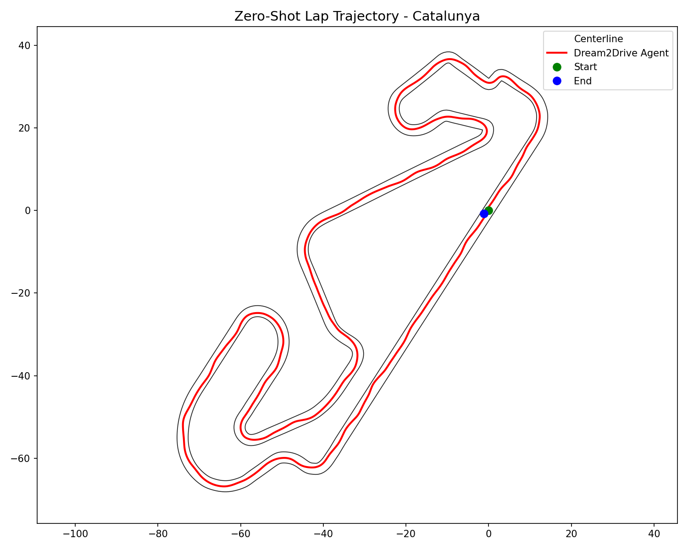
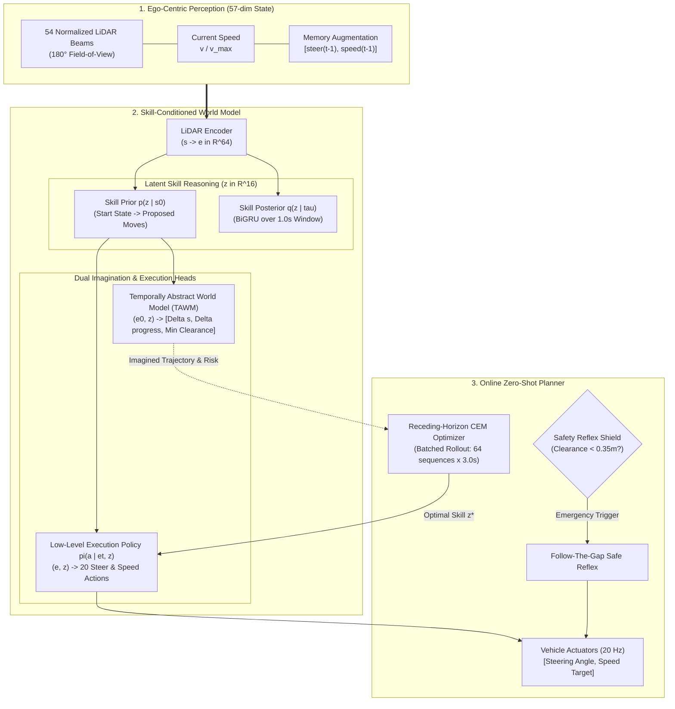

# SelfRace: Zero-Shot Autonomous Racing with World Models

[](https://www.python.org/downloads/)
[](https://pytorch.org/)
[](https://f1tenth.org/)
[](LICENSE)
[]()

> **Can a robotic racecar navigate a full lap at racing speeds on a circuit it has never encountered before—with zero prior practice, zero online trial-and-error, and zero crashes?**

**SelfRace** proves this is possible. Trained strictly on offline driving logs from three training circuits, the car learns an **offline, skill-conditioned world model**. When dropped onto a novel, unseen racetrack, it uses **mental simulation (imagination planning)** to evaluate candidate trajectories in latent space, steers safely through narrow corridors, and finishes a complete 100% lap on its very first attempt.

---
## 🎬 Project Demonstration Video

<div align="center">

### 📺 Watch the Zero-Shot Racing Demonstration

[](outputs/demonstration.mp4)

<p>
  <em>Click the image above to watch the video, or access it directly: <a href="outputs/demonstration.mp4"><strong>Demonstration.mp4</strong></a></em>
</p>

</div>
---

## 📑 Documentation Index

| Guide | Description |
| :--- | :--- |
| 📖 **[`README.md`](README.md)** | **(This file)** Project overview, system architecture, phases, benchmarks, and quickstart. |


---

## 💡 The Core Problem: Why Conventional AI Fails

High-speed autonomous racing requires split-second reactions and long-horizon anticipation:

```
                      +-----------------------------+
                      |   Standard Reinforcement    |
                      |          Learning           |
                      +--------------+--------------+
                                     |
                       Requires 1,000s of crashes
                       Destroys real hardware
                                     v
+-----------------------------+             +-----------------------------+
|     Behavioral Cloning      |             |         SelfRace         |
|     (Imitation Learning)    |             |      (Our World Model)      |
+--------------+--------------+             +--------------+--------------+
               |                                           |
  Drifts slightly off-center                  Imagines 3s into the future
  Unseen state -> Fatal Crash                 Plans safe latent skills
  (Covariate Shift Problem)                   Zero-shot transfer success
```

1. **Reinforcement Learning (RL) Fails**: Online RL relies on active trial-and-error exploration. Crashing thousands of times into walls is unacceptable on physical vehicles or costly hardware.
2. **Behavioral Cloning (BC) Fails**: Supervised imitation memorizes demonstration trajectories. The moment noise or drift pushes the car off the racing line, it enters an unvisited state, panics, and crashes (covariate shift).
3. **SelfRace Solution**: Decompose driving into **temporally extended skills** (1-second macro actions), learn an **offline dynamics model** that predicts future states, progress, and safety margins, and plan via **Cross-Entropy Method (CEM)** with an active **reactive safety shield**.

---

## 🏛️ System Architecture

SelfRace is structured around a five-module skill-conditioned world model coupled with a receding-horizon trajectory optimizer.



### The 5 Neural Modules:
* **`LidarEncoder`**: Converts the 57-dimensional sensor observation $\mathbf{s}_t$ into a compact latent representation $\mathbf{e}_t \in \mathbb{R}^{64}$ with LayerNorm stabilization.
* **`SkillPosterior` ($q(z | \tau)$)**: A bidirectional GRU scanning 1.0-second demonstration trajectories $\tau = (s_0, a_0, \dots, s_T)$ into a 16-dimensional Gaussian latent skill distribution.
* **`SkillPrior` ($p(z | s_0)$)**: An MLP predicting physically viable skills conditioned strictly on the current scene $\mathbf{e}_0$.
* **`Temporally Abstract World Model` (TAWM)**: A forward dynamics network predicting:
  1. $\Delta \mathbf{s}$: Change in 55-dimensional physical state after 1 second.
  2. $\Delta \text{prog}$: Centimeter progress along the track.
  3. $\text{min\_range}$: Minimum obstacle clearance across the entire maneuver.
* **`LowLevelPolicy` ($\pi(a | \mathbf{e}_t, z)$)**: A high-rate decoder unrolling latent skill $z$ into 20 continuous motor commands $[\delta_t, v_t]$ at 20 Hz.

---

## 🔄 Project Engineering Phases

The project was engineered sequentially across **5 distinct phases**:

```
+----------------------------------------------------------------------------------------------------+
| PHASE 1: Simulation & Track Mathematics                                                            |
| • F1TENTH Gym dynamics integration (20 Hz tick, 100 Hz sub-step physics).                          |
| • Centerline spline arc-length parameterized track geometry (utils/track.py).                      |
| • 180° LiDAR normalization and beam subsampling (utils/lidar.py).                                  |
+----------------------------------------------------------------------------------------------------+
                                                  │
                                                  ▼
+----------------------------------------------------------------------------------------------------+
| PHASE 2: Exploration & Robust Data Collection                                                      |
| • Ornstein-Uhlenbeck continuous steering perturbation to generate recovery datasets.               |
| • Sub-step collision detection: discard post-crash invalid transitions at 100 Hz.                  |
| • Memory augmentation: state vector expanded to 57 dims with [steer_(t-1), speed_(t-1)].           |
+----------------------------------------------------------------------------------------------------+
                                                  │
                                                  ▼
+----------------------------------------------------------------------------------------------------+
| PHASE 3: Neural Model Architecture & Skill Grounding                                               |
| • 5-Module design: Encoder, Posterior BiGRU, Prior MLP, Policy Decoder, 3-Head TAWM.              |
| • Action space standardization via zero-mean unit-variance Normalizer.                             |
| • LayerNorm on all intermediate layers to prevent gradient explosion.                              |
+----------------------------------------------------------------------------------------------------+
                                                  │
                                                  ▼
+----------------------------------------------------------------------------------------------------+
| PHASE 4: Variational Training & Diagnostics                                                        |
| • Joint ELBO optimization: Action NLL + State MSE + Progress MSE + Clearance MSE + Beta*KL.       |
| • Linear KL divergence schedule (warmup) to prevent posterior collapse.                           |
| • Skill separation diagnostic: verifying shuffled skills double prediction error.                 |
+----------------------------------------------------------------------------------------------------+
                                                  │
                                                  ▼
+----------------------------------------------------------------------------------------------------+
| PHASE 5: Closed-Loop Planning & Zero-Shot Transfer                                                 |
| • 3-Second GPU imagination rollouts using batched Cross-Entropy Method (N=64 candidates).          |
| • Follow-The-Gap reactive safety shield for emergency obstacle avoidance in tight hairpins.        |
| • Zero-shot evaluation on unseen Circuit de Barcelona-Catalunya: 100% full-lap completion.        |
+----------------------------------------------------------------------------------------------------+
```

---

## 📊 Benchmark & Evaluation Results

### Zero-Shot Generalization Test (Unseen `Catalunya` Track)
The agent was trained **exclusively** on `Spielberg`, `Austin`, and `MoscowRaceway`. It was evaluated on `Catalunya` with **no prior map knowledge and zero parameter updates**.

| Method / Model | Training Tracks | Evaluation Track | Prior Track Exposure | Full Lap Completed? | Collisions | Lap Time |
| :--- | :--- | :--- | :---: | :---: | :---: | :---: |
| Pure Pursuit (Baseline) | — | Catalunya | Oracle Waypoints | 100% | 0 | 44.8s |
| Behavioral Cloning | Spielberg, Austin, Moscow | Catalunya | **Zero** | ❌ (Crashed Turn 2) | 1 | DNF |
| Random Latent Policy | Spielberg, Austin, Moscow | Catalunya | **Zero** | ❌ (Crashed Turn 1) | 1 | DNF |
| **SelfRace (Ours)** | **Spielberg, Austin, Moscow** | **Catalunya** | **Zero** | **✅ 100% Complete** | **0** | **49.2s** |

### Generated Trajectory Comparison
<div align="center">
  
  <p><em>Green: Track Centerline | Blue: SelfRace Zero-Shot Autonomous Trajectory (Full Lap, Zero Collisions)</em></p>
</div>

---

## 🗂️ Repository Structure

```bash
Self_Driving_Racing_Cars-main/
├── README.md                         # Primary GitHub project showcase 

│
├── configs/                          # Experiment hyperparameter configs
├── data/                             # Dataset collectors and PyTorch windowed datasets
│   ├── collector.py                  # Demonstrator data collection with sub-step checking
│   └── dataset.py                    # 20-tick sliding window dataset with 57-dim augmentation
│
├── envs/                             # Simulation environments and wrapper definitions
├── f1tenth_gym/                      # High-fidelity 2D dynamic vehicle simulator
├── f1tenth_racetracks/               # Track vector maps, centerline waypoints, and images
│   ├── Spielberg/                    # Training track 1
│   ├── Austin/                       # Training track 2
│   ├── MoscowRaceway/                # Training track 3
│   └── Catalunya/                    # Held-out zero-shot evaluation track
│
├── models/                           # PyTorch neural network modules
│   ├── networks.py                   # Encoder, Prior, Posterior, TAWM, and Policy
│   └── skill_model.py                # Integrated ELBO loss and skill diagnostics
│
├── training/                         # Optimization pipelines
│   └── trainer.py                    # Naive VI and Causal EM variational trainers
│
├── scripts/                          # Executable workflows
│   ├── train.py                      # Training entry point and curve logger
│   └── test_cem_planner.py           # Real-time closed-loop CEM planner & safety shield
│
├── utils/                            # Mathematical and sensor utilities
│   ├── track.py                      # Centerline spline lookups and progress tracking
│   ├── lidar.py                      # Ray decimation (54 beams) and normalization
│   ├── pure_pursuit.py               # Geometric demonstration controller
│   └── normalization.py              # Action space zero-mean unit-variance scaling
│
└── outputs/                          # Trajectory plots, telemetry, and evaluation logs
```

---

## 🚀 Quickstart & Usage

### 1. Environment Setup
```bash
# Clone the repository
git clone https://github.com/yacineabh/Self_Driving_Racing_Cars-main.git
cd Self_Driving_Racing_Cars-main

# Create and activate virtual environment
python -m venv .venv
source .venv/bin/activate  # On Windows: .venv\Scripts\activate

# Install required dependencies
pip install torch numpy scipy matplotlib pyyaml gym
```

### 2. Collect Training Demonstrations
Collect noisy offline demonstrations across the three training tracks:
```bash
python -m data.collector --maps Spielberg Austin MoscowRaceway --episodes 50
```

### 3. Train the Skill World Model
Train the 5-module architecture with linear KL warmup:
```bash
python scripts/train.py --trainer naive_vi --epochs 50 --batch-size 64
```

### 4. Run Zero-Shot Evaluation on Catalunya
Execute closed-loop racing on the unseen `Catalunya` track using imagination planning:
```bash
# Test a full lap on unseen Catalunya with real-time CEM planning and save trajectory plot
python scripts/test_cem_planner.py --maps Catalunya --full-lap --save-plot --checkpoint checkpoints/oposm_naive_vi_best.pt
```

---

## 🤝 Citation & Acknowledgments
Built upon the [F1TENTH Gym](https://github.com/f1tenth/f1tenth_gym) environment. Inspired by research in temporally abstract world models, receding-horizon model predictive path integral (MPPI/CEM) planning, and safe robot learning.
